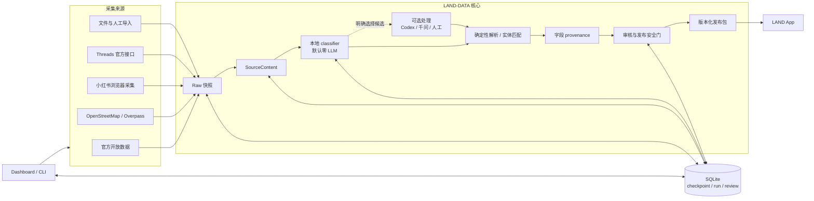

# LAND-DATA 架构

LAND-DATA 把采集、分类、审核和发布拆成可恢复的阶段。默认路径使用确定性代码；模型处理由明确启用的入口及其预算控制；人工或 Codex 辅助审核依据待审对象进行。知识抽取需要明确候选 ID，地点抽取也可从显式启用的待处理队列进入，不应概括为所有入口都按 ID 选择。

## 阶段边界

1. **采集**保存可追溯的 Raw 快照和来源身份，并用 checkpoint 支持断点续跑。
2. **规范化**生成 `SourceContent`，保留来源 URL、采集时间和内容指纹。
3. **本地分类**判断地点、活动、知识、文化礼仪、模糊内容与无关内容，记录版本、置信度和原因。
4. **确定性处理**优先使用结构化字段、稳定 ID、本地 POI 库和固定规则。
5. **可选处理**按入口校验显式启用条件；知识抽取要求候选 ID 和 limit，地点抽取按其队列／命令契约执行。不同入口的 limit 不构成系统统一 token 或金额预算。
6. **审核和 provenance**共同控制发布资格；分类结果本身不等于事实核验或发布批准。
7. **发布桥**生成可核对、可验证和可回滚的版本包，再安装到相邻的 LAND App 仓库。

## 数据与运行状态

- SQLite 保存实体、来源内容、分类、审核决定、来源运行和 checkpoint。
- `.local/` 保存本地数据库、浏览器采集文件、运行日志和发布包，不进入 Git。
- 采集来源互相隔离；一个来源失败时，已提交的其他来源成果继续保留。
- LAND App 是独立仓库；LAND-DATA 的单元测试使用仓库内 fixture，不要求开发机存在相邻 LAND checkout。

## 发布与地点核验的边界

QAU `publish` 与 Place `place-publish` 均已有独立发布桥；普通 `export` 保持自己的数据 schema，Event 和官方指导快照尚无通用 App 发布桥。Place 的类别、语言与经验字段存在公开版／本地工作区差异，见[实现状态](implementation-status.md)。

Location Verification 是开发期单案 Harness：Case 经冻结只读工具、固定顺序或千问决策、独立 Goal Gate 后生成验证结果或人工交接包，执行记录保存在独立 SQLite journal。它不是上述主流水线默认步骤。只有显式冲突 hold 才能改变符合条件的业务对象审核状态；完整人工裁决及发布前联动仍待完成。
