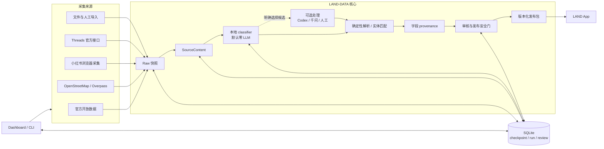

# LAND-DATA 架构

LAND-DATA 把采集、分类、审核和发布拆成可恢复的阶段。默认路径使用确定性代码；只有操作者明确选择候选时才会进入 Codex、千问或人工审核。

## 阶段边界

1. **采集**保存可追溯的 Raw 快照和来源身份，并用 checkpoint 支持断点续跑。
2. **规范化**生成 `SourceContent`，保留来源 URL、采集时间和内容指纹。
3. **本地分类**判断地点、活动、知识、文化礼仪、模糊内容与无关内容，记录版本、置信度和原因。
4. **确定性处理**优先使用结构化字段、稳定 ID、本地 POI 库和固定规则。
5. **可选处理**只处理操作者明确选择的候选，并受调用上限约束。
6. **审核和 provenance**共同控制发布资格；分类结果本身不等于事实核验或发布批准。
7. **发布桥**生成可核对、可验证和可回滚的版本包，再安装到相邻的 LAND App 仓库。

## 数据与运行状态

- SQLite 保存实体、来源内容、分类、审核决定、来源运行和 checkpoint。
- `.local/` 保存本地数据库、浏览器采集文件、运行日志和发布包，不进入 Git。
- 采集来源互相隔离；一个来源失败时，已提交的其他来源成果继续保留。
- LAND App 是独立仓库；LAND-DATA 的单元测试使用仓库内 fixture，不要求开发机存在相邻 LAND checkout。
